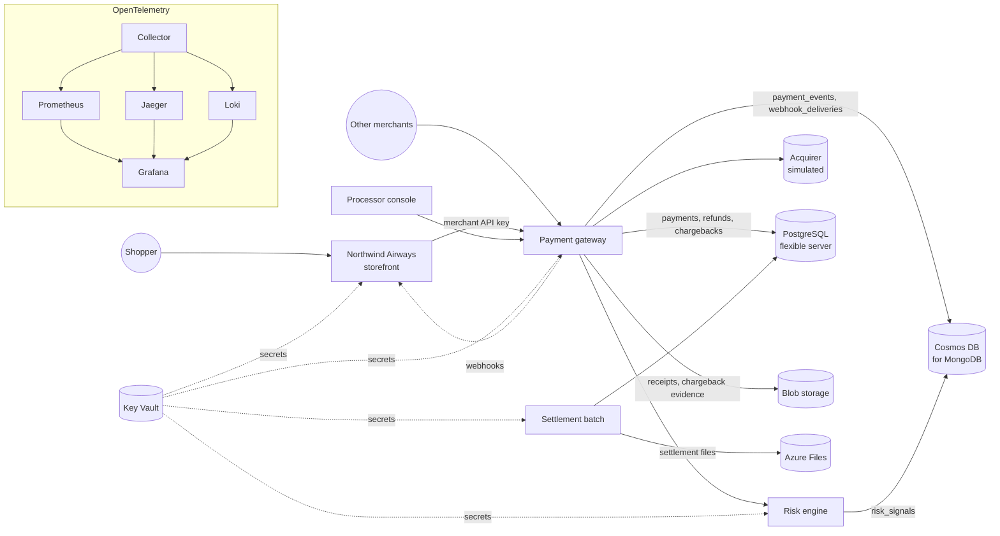

# Contoso Pay: a payments company on Azure

A realistic DevOps estate for a fictional payment service provider, built to run
entirely on the CloudTyke emulator. It has two halves:

- **[`terraform/`](terraform)**: the Azure estate as a platform team would own it.
  Seven teams, 30 people, 23 groups, PCI-DSS guardrails in Azure Policy, a hub-and-spoke
  network, a private AKS cluster with workload identity, Key Vault, Blob and Files
  storage, PostgreSQL and Cosmos DB for MongoDB.
- **[`apps/`](apps)**: the live system on top of that estate. A merchant storefront, the
  payment gateway, a risk engine, a processor console, a settlement batch and a
  traffic generator. They make real calls to Key Vault, Blob and Files, use real
  PostgreSQL and MongoDB, and are traced end to end with OpenTelemetry.

> **Everything here is invented.** Contoso Pay, Northwind Airways, Fabrikam Hotels,
> Tailspin Toys, Woodgrove Acquiring and every person, card and payment are fictional.
> Card numbers are the publicly documented test numbers that card networks and PSPs
> publish for testing. None of them can move money.



## Run it

You need Docker and about 4 GB of free memory.

```bash
cd azure-emulator
scenarios/contoso-pay/apps/scripts/up.sh            # OpenTofu; TOOL=terraform also works
```

The script starts the emulator, deploys the estate (about two minutes the first
time), reads the outputs and Key Vault secrets into `apps/.env`, and starts the apps:

| What | URL |
|---|---|
| Northwind Airways storefront | http://localhost:4701 |
| Contoso Pay processor console | http://localhost:4703 |
| Payment gateway API | http://localhost:4702 |
| Grafana (dashboard *Contoso Pay · Payments (live)*) | http://localhost:4730 |
| Jaeger | http://localhost:4731 |
| Prometheus | http://localhost:4732 |

Everything binds to `127.0.0.1`. Grafana allows anonymous read-only access on
localhost; the admin password is `GRAFANA_ADMIN_PASSWORD` in `apps/.env`. To expose
the demo on your LAN set `CPAY_BIND=0.0.0.0` *and* `GRAFANA_ANONYMOUS=false`.

Tune the load with `TRAFFIC_TPS` (default 1.5 payments per second) and the settlement
cadence with `SETTLEMENT_INTERVAL_MS` (default two minutes). Stop with
`docker compose -f scenarios/contoso-pay/apps/docker-compose.yml down` (add `-v` to
drop the payment data).

## The company

| Team | Cost centre | Owns |
|---|---|---|
| Platform Engineering | CC-1000 | hub network, AKS, registry, logging |
| Site Reliability | CC-1100 | on-call, observability |
| Payments Core | CC-2100 | payment gateway, PostgreSQL ledger, receipts |
| Risk & Fraud | CC-2200 | risk engine, fraud signals |
| Merchant Experience | CC-3100 | merchant portal, onboarding (KYC), storefront demos |
| Data & Settlement | CC-4100 | settlement batch, Azure Files shares |
| Security Operations | CC-5000 | Azure Policy, exemptions, audit |

Thirty people (`locals.tf`) belong to groups such as `grp-cpay-payments-dba` (the
PostgreSQL Entra administrators), `grp-cpay-pci-cde-access` (quarterly-reviewed
access to the cardholder data environment) and `grp-cpay-breakglass`. Every permission
is granted to a group, never a person. Each team's GitHub repository deploys through an
app registration with a federated credential, so CI holds no secrets.

Three subscriptions, as in most regulated platforms:

- **payments-prod** (`sub-sandbox`): the cardholder data environment (CDE)
- **connectivity** (`sub-connectivity`): the hub VNet and private DNS zones
- **management** (`sub-management`): Log Analytics with one year of retention

## Guardrails (Azure Policy)

The initiative **Contoso Pay PCI-DSS v4.0 baseline** is assigned to payments-prod:

| Policy | Effect | Try it |
|---|---|---|
| Resources must be deployed in the UK | deny | create anything in `westeurope` |
| Resource groups need cost-centre, team, data-classification tags | deny | `az group create -n rg-x -l uksouth` |
| Storage: no public blob access, HTTPS only, TLS 1.2+ | deny | set `allow_nested_items_to_be_public = true` |
| Storage in the CDE uses Entra ID, not shared keys | deny | set `shared_access_key_enabled = true` |
| Key vaults use RBAC and purge protection | deny | set `purge_protection_enabled = false` |
| PostgreSQL has no public network access | deny | drop the delegated subnet |
| AKS uses Azure RBAC with local accounts disabled | deny | set `local_account_disabled = false` |
| No public IP addresses in the CDE | deny | add an `azurerm_public_ip` |
| Cosmos DB disables key-based auth | audit | already non-compliant: the Mongo API needs keys |
| Production data stores cannot be deleted | denyAction | `terraform destroy` while `protect_data = true` |

A separate assignment with a managed identity **modifies** new resources so they inherit
the resource group's `cost-centre` tag.

The **legacy acquirer** share needs a storage key for one more quarter, so its resource
group has a time-boxed *Waiver* exemption (ticket RISK-1182, expires 2027-03-31) for that
one policy, instead of a weaker baseline for everyone.

Denials come back exactly as Azure sends them:

```
Error: creating Storage Account ...: RequestDisallowedByPolicy: Resource 'stdemo' was
disallowed by policy. Reasons: 'Blocked by the Contoso Pay PCI-DSS baseline. See
https://wiki.contoso-pay.example/platform/policies or ask #platform-help.'
```

Compliance is queryable like Azure Policy Insights:

```bash
make shell      # then, inside the toolbox:
TOKEN=$(curl -s "https://login.cloudtyke.local/$ARM_TENANT_ID/oauth2/v2.0/token" \
  -d grant_type=client_credentials -d client_id=$ARM_CLIENT_ID \
  --data-urlencode client_secret=$ARM_CLIENT_SECRET \
  -d scope=https://management.cloudtyke.local/.default | jq -r .access_token)
curl -s -X POST -H "Authorization: Bearer $TOKEN" \
  "https://management.cloudtyke.local/subscriptions/$ARM_SUBSCRIPTION_ID/providers/Microsoft.PolicyInsights/policyStates/latest/summarize?api-version=2019-10-01" | jq
```

### Decommissioning a data store

The PostgreSQL server and the Cosmos DB account carry `protect=true`, so a plain
`destroy` fails with `RequestDisallowedByPolicy`, which is the point. Teardown follows
the change-request path: apply with `protect_data = false` (see
`terraform/e2e-teardown.tfvars`), then destroy.

## Data and secrets

| Store | What lives there | Who can read it |
|---|---|---|
| Key Vault `kv-cpay-pay-*` | Postgres host and password, Mongo connection string, PAN tokenisation key, webhook signing key, acquirer API key | gateway, risk engine, settlement (Secrets User); payments leads (Officer); SecOps (metadata only) |
| Key Vault `kv-cpay-mrch-*` | merchant API keys (`northwind-airways-api-key`, ...) | storefront, merchant portal, gateway |
| PostgreSQL `psql-cpay-payments-*` | `merchants`, `payments`, `refunds`, `chargebacks`, `settlement_batches` | private subnet only; Entra admins = `grp-cpay-payments-dba` |
| Cosmos DB `cosmos-cpay-events-*` | `payment_events`, `risk_signals` (90-day TTL), `webhook_deliveries` (30-day TTL) | services; fraud analysts read-only |
| Blob `stcpayrcpt*` | `receipts/yyyy/mm/dd/pay_*.json` (cool after 30 days, archive after a year, delete after seven), `chargeback-evidence/`, `audit-exports/` | gateway; SecOps reads audit exports |
| Blob `stcpaykyc*` | merchant KYC documents, storefront assets (versioned) | merchant portal |
| Files `stcpaysettle*` | `settlement-outbound/<date>/<merchant>/stl_*.csv`, `reconciliation/`, `acquirer-inbound/` | settlement batch; settlement engineers over SMB |

On AKS each workload signs in with **workload identity** (a user-assigned identity with a
federated credential for its Kubernetes service account). Under docker compose there is
no service-account token to exchange, so the apps use the `app-cpay-local-dev` service
principal, which has the same data-plane roles and nothing else.

The emulator manages the PostgreSQL server and Cosmos account as Azure resources, but
it does not run database engines. The compose file runs `postgres:17` and `mongo:8` as
stand-ins, reachable at the server's FQDN and the account's Mongo host, with the
password and key that Terraform generated and stored in Key Vault. The apps find all
of them through Key Vault, as they would in Azure.

## The live system

| Service | Team | What it does |
|---|---|---|
| `northwind-storefront` | Merchant Experience | Flight booking site for the fictional Northwind Airways. Checkout calls the gateway with the merchant key from Key Vault and receives signed webhooks. |
| `payment-gateway` | Payments Core | Authenticates merchants, tokenises the card (HMAC key from Key Vault), asks the risk engine, simulates the acquirer, writes the ledger, events and a receipt in Blob storage. Refunds and chargebacks (with evidence in Blob). |
| `risk-engine` | Risk & Fraud | Scores amount, geography, high-risk countries and card velocity from `risk_signals`: approve, review, or block. |
| `processor-portal` | Merchant Experience | The operations console: live payments, authorisation rates, declines, risk review queue, chargebacks and settlement files read from Azure Files. Every row links to its trace. |
| `settlement-batch` | Data & Settlement | Nets captured payments per merchant, takes the fee, writes CSV settlement files and reconciliation summaries to Azure Files. |
| `traffic-generator` | (synthetic) | Invented shoppers at about 1.5 payments a second; refunds, chargebacks, and a card-testing attack against Tailspin Toys every four minutes. |

Test cards: `4242 4242 4242 4242` (Visa) and `5555 5555 5555 4444` (Mastercard) succeed;
`4000 0000 0000 0002` is declined, `…9995` has insufficient funds, `…0069` is expired,
`4100 0000 0000 0019` is a high-risk BIN that the risk engine blocks.

## OpenTelemetry

Every service loads the Node.js SDK with auto-instrumentation (`src/otel.js`), so HTTP,
Express, `pg`, the MongoDB driver, `fetch` (all Key Vault, Blob and Files calls) and pino
logs are captured without touching the business code. The code adds domain spans
(`acquirer.authorise`, `settlement.run`), attributes (`cpay.payment_id`, `cpay.risk_score`
and others) and metrics (`cpay.payments`, `cpay.acquirer.latency`, `cpay.risk.score`,
`cpay.settlement.net` and others).

The collector sends traces to Jaeger, metrics to Prometheus and logs to Loki. It also
derives RED metrics and a service graph from the spans (`spanmetrics` and
`servicegraph` connectors). Grafana has all three as data sources, linked together:
log lines link to their trace, and traces link to their logs.

Things to look at:

1. **A checkout, end to end.** Book a flight on the storefront, then open the payment's
   *trace ↗* link in the processor console. One trace covers storefront → gateway →
   Key Vault → risk engine → MongoDB → acquirer → PostgreSQL → Blob → webhook back to
   the storefront.
2. **The card-testing attack.** Every four minutes, *Risk decisions* in Grafana spikes to
   `block` and *Blocked by risk / min* turns red. The warnings appear in the logs panel.
3. **The acquirer's long tail.** About 3% of authorisations are slow and some time out
   (`issuer_unavailable`). Compare p50 with p99 in *Acquirer latency*, then find a slow
   trace in Jaeger.
4. **Settlement.** Every two minutes a batch lands in the console. Click the file name to
   read the CSV back from Azure Files.

## Validate the Terraform alone

```bash
cd azure-emulator
make tf-e2e EXAMPLES=scenarios/contoso-pay/terraform        # init, apply, no-drift plan, destroy
```

The e2e run and the live demo create the same resource-group names, so run the e2e on a
fresh emulator (`make reset`) rather than next to a running demo.
